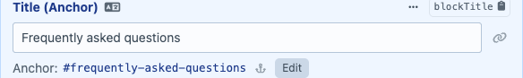
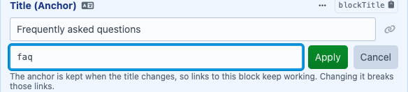
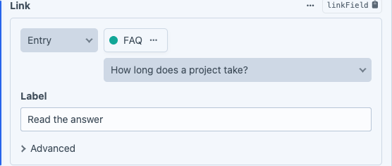
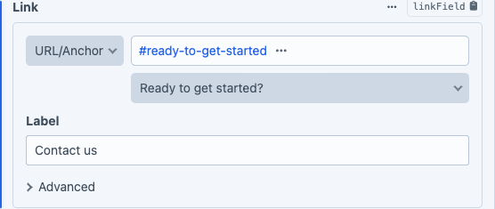

# Entry Anchors

Link to a block on a page. Editors give a block an anchor title, and Link fields get dropdowns with the anchors to link to.

- **Anchor Text field**: a block's title and its anchor. The anchor follows the title while the block is new and is kept after
  that, so links keep working when the title changes. The front end renders it as the heading's id with `anchor_id()`. Two
  subtle buttons copy the link to the block and its anchor.
- **Anchor dropdown for linked entries**: when an editor picks an entry in a Link field, a dropdown next to it lists the anchors
  on that entry (the Anchor Text fields on the entry and its nested entries, in page order). The chosen anchor is stored in the
  Link field's URL suffix as `#slug`, so `link.url` ends with it. No template changes needed.
- **Anchor dropdown for the same page**: Link fields whose URL type allows anchors get a dropdown with the anchors of the page
  the field is on; choosing one sets the URL to `#slug`.

## Requirements

Craft CMS 5.10 or later, PHP 8.2 or later.

## Installation

```bash
composer require statikbe/craft-entry-anchors
php craft plugin/install entry-anchors
```

## Usage

### Anchor Text field

Create a field of the "Anchor Text" type (e.g. "Title (Anchor)") and add it to the entry types of your blocks. Render the title
with its anchor as id:

```twig

    <h2 id="{{ anchor_id(block.blockTitle) }}">{{ block.blockTitle }}</h2>

```

In templates the field's value is the title (`{{ block.blockTitle }}`, `block.blockTitle|length`); the anchor is
`block.blockTitle.anchor`.

`anchor_id()` keeps ids unique on the page: a second block with the same anchor gets `-2`, a third `-3` … The first one keeps the
anchor, and that's where links to it go. It also takes a plain text and uses its slug.

#### The anchor

Below the title the editor sees the anchor (`Anchor: #how-long-does-a-project-take`) with an "Edit" button:



- while the block isn't on a published page yet (a new block, or one that only exists in a draft), the anchor follows the title,
  like Craft's entry slug;
- after that it is kept: changing the title doesn't change the anchor, so links to the block keep working;
- editors can change it, e.g. to make it shorter: "Edit" opens the anchor, and it only changes after "Apply" (or Enter);
  "Cancel" (or Escape) leaves it as it was. It is saved as a slug, and an empty anchor falls back to the title. Changing an
  anchor breaks the links that use the old one; the editor says so, and the dropdowns mark those links "not found".



#### Copy buttons

Two subtle buttons copy to the clipboard:

- after the title: the link to the block, the page URL + `#anchor` (not shown for entries without a URL);
- on the anchor line: only `#anchor`, e.g. for a link on the same page.

Values from before 1.0.0-beta.3 (only a title) get the slug of that title as anchor, the id they were rendered with.

### Anchor dropdown on Link fields

Enable "URL Suffix" under "Advanced fields" in the settings of a Link field with the "Entry" link type. The dropdown appears
next to the entry select:



- picking another entry loads its anchors and clears the anchor;
- a saved anchor that no longer exists on the entry stays selected, marked "not found";
- typing `#something` in the URL suffix selects it in the dropdown, query params (`?p=1`) are left alone;
- switching to another link type clears the anchor.

### Anchors on the same page

When the URL type of a Link field allows anchors ("Allow anchors" in its settings), the link type is called "URL/Anchor" and a
dropdown below the URL input lists the anchors of the page the field is on (the entry that owns it, also when the field is in
a nested entry). Choosing one sets the URL to `#slug`. When the Link field shows its "Label" field, the label becomes the anchor's title (as in the
dropdown), unless the editor typed a label of their own. The list is the page as it was saved (or autosaved) when the editor
opened it.



The dropdowns are added to Craft's Link field markup by JS. If a Craft update changes that markup, the dropdowns stay away and
anchors can still be typed.

## Configuration

Create `config/entry-anchors.php`:

```php
<?php

return [
    // How deep to look into nested entries for anchors (content builder → row → cell → FAQ items, ...)
    'maxDepth' => 3,
    // Handles of the Matrix fields to look into for anchors (the handle in the field layout), null for every Matrix field
    'fields' => null,
];
```

## Coming from the Statik module

Installing the plugin takes over the fields of the module's Anchor Link type (`modules\statik\fields\AnchorLink`). Their
content stays as it is. Remove the field type, the anchor dropdown and their assets from the module in the same deploy.
